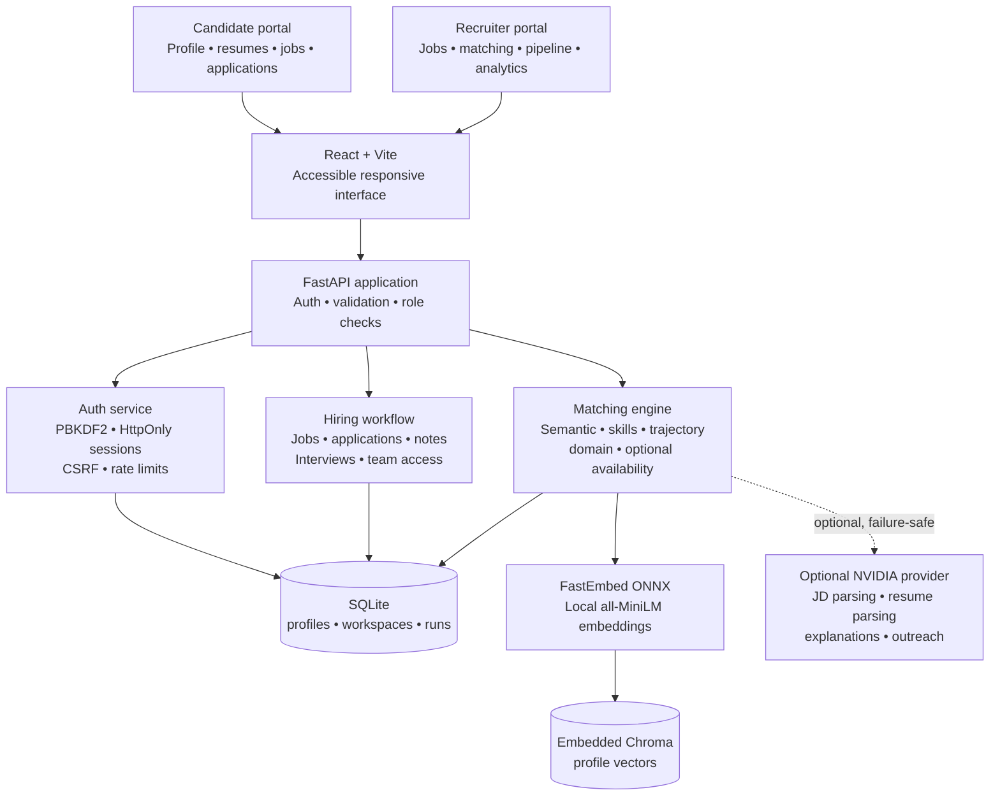
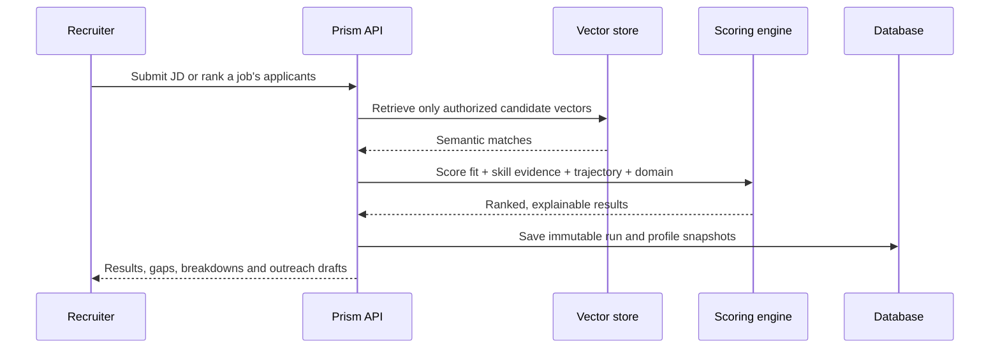

# Prism

<p align="center">
  <strong>Evidence-aware hiring workflows for recruiters and candidates.</strong><br />
  Match candidates to roles, run a structured hiring pipeline, and keep candidates in control of their data.
</p>

<p align="center">
  <a href="https://github.com/HarshitaAsija/Prism/actions"></a>
  
  
  
</p>

## Why Prism

Hiring tools frequently optimize only for recruiters. Prism is deliberately two-sided: recruiters get a practical workspace for sourcing, ranking and progressing applicants, while candidates own their profile, choose their visibility and can export or erase their data.

The matching system is inspectable. Instead of presenting an opaque “AI score” as a hiring decision, Prism shows an evidence-aware fit signal with skill gaps, score breakdowns, explanations and a human-in-the-loop workflow.

> **Prism is a decision-support tool, not an automated hiring system.** Scores are matching heuristics, not hiring probabilities. Humans remain responsible for every hiring decision.

## What makes it stand out

| | Prism capability | Why it matters |
| --- | --- | --- |
| 🔒 | **Secure, tenant-aware foundation** | PBKDF2-SHA256 password hashing, expiring HttpOnly sessions, CSRF protection, rate limiting and role-aware data boundaries. |
| 🎯 | **Evidence-aware matching** | Semantic retrieval, skill coverage, trajectory and domain signals combine into a transparent 0–100 score. Skills listed without supporting evidence are discounted. |
| 🤝 | **Real two-sided workflow** | Candidates discover jobs, check coverage and apply; recruiters post jobs, rank only their applicants and progress an auditable pipeline. |
| ⚖️ | **Fairer defaults** | Activity/availability data is excluded from the default composite score and is only included through an explicit recruiter choice. |
| 🧭 | **Candidate control** | Profiles are private by default. Candidates can export their stored data or permanently delete their account. |
| 🛡️ | **Honest AI behavior** | Provider failures return an explicit unavailable state—never fabricated analyses, explanations or scores. |

## Product walkthrough

### For recruiters

1. Create a workspace and post a role with its description and required skills.
2. Discover visible profiles or import a bounded CSV candidate list.
3. Run evidence-aware matching, inspect score breakdowns and skill gaps, and adjust weights for the role.
4. Open a job and select **Rank applicants** to compare only active applicants against that role.
5. Move people through screening, interview, offer, hired or rejected stages; keep internal notes private and schedule interviews.
6. Export a saved ranking run as a formula-safe CSV, review analytics, or invite a teammate.

### For candidates

1. Create and edit a persistent profile, including skills, experience, links and visibility.
2. Upload a text-based PDF or DOCX resume for structured extraction.
3. Browse open jobs, check required-skill coverage and receive concrete suggestions for missing or weaker evidence.
4. Apply with a private profile: it is shared only with that job’s recruiter workspace.
5. Track application stages and interviews, withdraw active applications, download stored data or delete the account.

## Architecture



### Matching lifecycle



## Feature map

| Area | Included |
| --- | --- |
| Authentication | Signup, login, logout, session expiry, account roles, CSRF header check and request throttling |
| Candidate experience | Private/public visibility, profile builder, PDF/DOCX resume extraction, skill guidance, applications, interview visibility, export and deletion |
| Recruiter workspace | Job posting, candidate discovery, applicant-only ranking, feedback preview, hiring stages, internal notes, interview scheduling, CSV export and team invitations |
| Matching | Local semantic retrieval, aliases and token-safe skill matching, skill-evidence discounting, career trajectory, domain relevance, transparent score weights and feedback reranking |
| Reliability | Additive database migrations, atomic ranking-run writes, profile snapshots, vector-index recovery, bounded file uploads and parameter validation |
| Quality controls | Backend tests, frontend unit tests, Playwright browser flows, linting, production build and GitHub Actions CI |

## Technical decisions

### Transparent scoring over a black box

Prism combines five understandable signals: semantic fit, skill evidence, career trajectory, domain relevance and an optional availability signal. Weights are normalized and saved with every run so a historical ranking stays reproducible. By default, availability is weighted at **0%**.

### Secure by default

Candidate ownership and recruiter workspace boundaries are enforced at the data-access layer, not only in the interface. Profiles are private by default; a private profile becomes visible to a recruiter when the candidate chooses to apply to that recruiter’s job.

### Graceful AI degradation

The product still supports account creation, profile management, jobs, applications, coverage checks and hiring stages without provider credentials. When an optional AI action cannot run, the API responds with an explicit error instead of inventing output.

## Tech stack

| Layer | Technologies |
| --- | --- |
| Frontend | React 18, Vite, Tailwind CSS, Axios, Recharts, Framer Motion |
| API | Python 3.11, FastAPI, Pydantic, Uvicorn |
| Data | SQLite with additive migrations; embedded Chroma vector storage |
| Retrieval | FastEmbed / ONNX with `all-MiniLM-L6-v2` embeddings |
| AI enrichment | Configurable NVIDIA-compatible model for JD parsing, resume extraction, explanations and outreach |
| Verification | Pytest, Ruff, Node test runner, Playwright and GitHub Actions |

## Quick start

### Prerequisites

- Python 3.11
- Node.js 22.12+ (Node 24 also works)
- An NVIDIA-compatible API key only for optional AI enrichment

### 1. Start the API

```powershell
git clone https://github.com/HarshitaAsija/Prism.git
cd Prism
python -m venv .venv
.venv/Scripts/python.exe -m pip install --upgrade pip
.venv/Scripts/python.exe -m pip install -r backend/requirements.txt -r backend/requirements-dev.txt
Copy-Item backend/.env.example backend/.env
.venv/Scripts/python.exe -m uvicorn main:app --app-dir backend --reload --port 8000
```

### 2. Start the frontend

```powershell
cd frontend
npm ci
npm run dev
```

Open [http://localhost:5173](http://localhost:5173). Interactive API documentation is at [http://localhost:8000/docs](http://localhost:8000/docs).

Use one hostname consistently for both services—do not mix `localhost` and `127.0.0.1`—because authentication uses browser cookies.

### Optional AI configuration

Set `NVIDIA_API_KEY` in `backend/.env` to enable JD analysis, resume parsing, bias scans, explanations and outreach drafts. The application deliberately does not fake successful AI responses when the key or provider is unavailable.

On macOS/Linux, create the environment with `python3 -m venv .venv`, activate with `source .venv/bin/activate`, then use `python` in the commands above.

## Demo data and administration

A fresh install is empty; nothing seeds or deletes data on startup. To add demonstration records deliberately to an **empty** database:

```powershell
.venv/Scripts/python.exe backend/seed.py
```

Seeded legacy records are initially unowned. Register the recruiter who should own them, then preview and apply the migration:

```powershell
.venv/Scripts/python.exe backend/migrate_legacy.py --owner recruiter@example.com
.venv/Scripts/python.exe backend/migrate_legacy.py --owner recruiter@example.com --apply
```

The migration creates a database backup first. Create an administrator only from the terminal:

```powershell
.venv/Scripts/python.exe backend/create_admin.py admin@example.com
```

## Safety and data boundaries

- Passwords are salted PBKDF2-SHA256 hashes; sessions are hashed, expiring and sent as HttpOnly cookies.
- The API validates ownership and recruiter workspace scope before reading or changing records.
- PDF, DOCX and CSV uploads have strict size/content limits. Scanned PDFs need OCR, which is intentionally not claimed as supported.
- Vector storage is embedded locally; do not expose a standalone Chroma server for this deployment.
- CSV export cells that could be interpreted as spreadsheet formulas are escaped.
- Read [SECURITY.md](SECURITY.md) before deploying publicly.

## Verification

```powershell
# Backend
.venv/Scripts/python.exe -m pytest -q
.venv/Scripts/ruff.exe check backend

# Frontend
cd frontend
npm test
npm run build

# Browser flows
npx playwright install chromium
$env:PRISM_PYTHON=(Resolve-Path ../.venv/Scripts/python.exe).Path
npm run test:e2e
```

Browser tests launch temporary API/frontend services with synthetic data and do not call live AI providers. GitHub Actions runs backend, frontend and browser checks on every push.

## Evaluation and roadmap

`backend/evaluate.py` reports precision, recall and NDCG for externally supplied human relevance labels. The checked-in example is explicitly synthetic; credible ranking claims require consented, representative profiles and independent reviewer labels.

Next production-oriented steps include a durable background-job queue for long ranking operations, a PostgreSQL deployment path, transactional email, OCR for scanned resumes, and independently evaluated hybrid retrieval. These are deliberately documented rather than overstated as implemented features.

## Repository guide

```text
frontend/              React product interface
backend/               FastAPI service, scoring engine and migrations
backend/scorer/        Individual evidence-aware scoring signals
backend/tests/         Security, workflow, vector and evaluation tests
backend/evaluation/    Label format and ranking-evaluation examples
.github/workflows/     Continuous integration
SECURITY.md             Deployment and dependency security notes
AUDIT_RESPONSE.md      Audit decisions and implementation record
```

## Contributing

Please open an issue before proposing a major architectural change. Keep pull requests focused, add or update tests for behavior changes, and avoid adding real candidate data or provider secrets to the repository.
